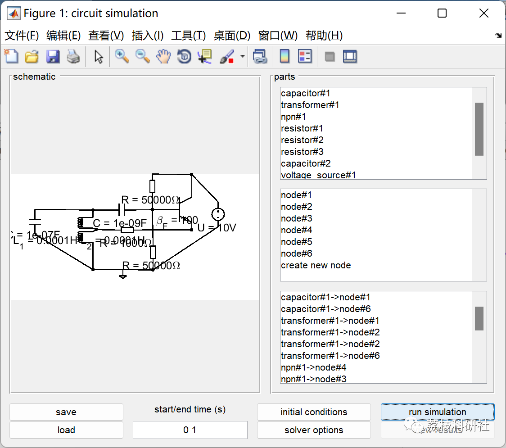
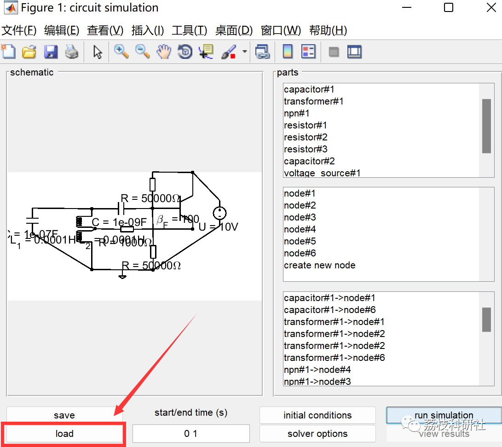
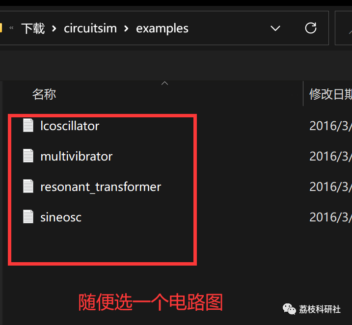
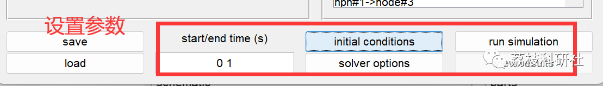
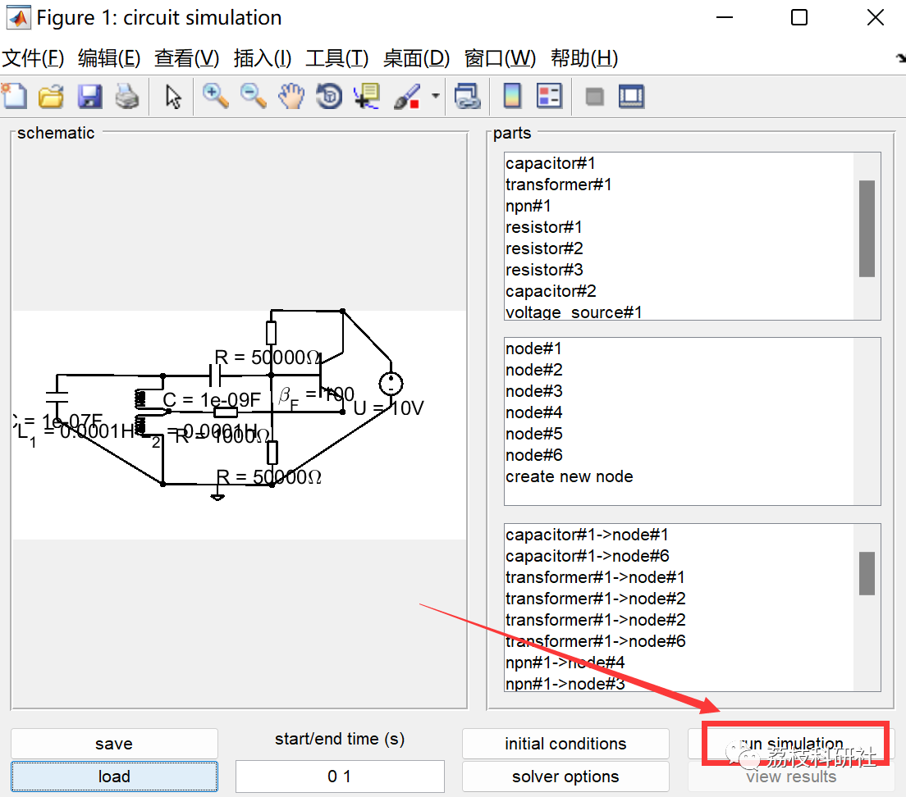

# Electronic Circuit Simulation (Matlab Code Implementation)

💞💞💞 Welcome to this blog❤️❤️❤️ 💥💥💥
🏆 Bloggers' Advantage: 🌞🌞🌞 The content of the blog strives for rigorous thinking and clear logic to facilitate readers.
⛳️ Mantra: A journey of a thousand miles is begun with a single step.
Litchi Research Society
Code Collection: Power Systems, Intelligent Algorithms and Applications, Neural Network Prediction, Path Planning, Optimized Scheduling, Workshop Scheduling, Image Processing, Signal Processing...
🎁 Special Section Links:
🌈🌈🌈🌟🌟🌟 Electrical Code Intelligent Algorithms and Their Applications Path Planning Neural Network Prediction Optimized Scheduling Image Processing Workshop Scheduling Signal Processing Romantic Her Thoughts Math Modeling Complete Code Issues
💥1 Overview
[Circuit Simulation Tool]This tool simulates analog electronic circuits. The schematic editor is interactive. The component library is still small but includes basic components. It includes passive components and some semiconductor component models. Most models are algebraic models. Semiconductor models are parameterized, so if you know the appropriate parameters, such as Eber/Moll transistor equations, they can fit to any "real-world" component.
The tool uses implicit differential equations to simulate electronic circuits. It may not be the most effective and powerful method, but it is very elegant. The equations use ode15i for solving. Therefore, all electronic components are modeled using implicit equations.
Therefore, modeling any type of component in various ways is very simple. Capacitors, inductors, resistors can be modeled with the same method f(U, dU/dt, I, dI/dt) = 0. In addition, we can use look-up tables to model real-world components, then we will get f=I-g(U), where g is the measurement characteristic of the component. Making your own component models is easy. Just look at the predefined and create a mat-file with the same structure. The tool just sets up all component equations with conservation equations according to the circuit and solves them using ode15i.
📚2 Run Results
Import different circuit diagrams, here is just one example:
1. Actual use:
1.1 Place components, nodes, and wires interactively. You can edit all content (right-click on any part of the schematic) through the context menu.
1.2 Calculate consistent initial conditions. For oscillators, incomplete symmetry of initial conditions is often important. If you start from a balanced state, even if it's unstable, you won't see oscillations. If the solver crashes at the beginning, it's likely that the initial conditions are inconsistent.
1.3 After simulation completion, you can plot the results. You will get graphs for all node voltages and all currents, except for the current flowing into the first terminal of the component. Generally, you don't need to see them because they are redundant (represented as negative sums of other currents flowing into the component). Additionally, you can draw the voltage and current of a specific component by right-clicking on it and selecting "Draw Results".
Please consider the following conventions:
1. All component terminals must be connected.
2. Wires connect component terminals and nodes.
3. Wires cannot directly connect component terminals to each other.
4. Wires cannot connect nodes to each other.
5. Node #1 always serves as a ground reference.
6. Do not construct circuits with electrically isolated components.
Limitations:
This is a tool for simulation simulation. It is not suitable for displaying transient behavior of circuits. It may work (as shown in the example of a multi-harmonic oscillator). But transient behavior is not a special advantage of this type of simulation method. All active components must be limited by bandwidth to avoid solver crashes. Therefore, transistors need some damping. It can be as low as 1e-6, but if it's zero, you will see many solver warnings.
🎉3 References
[1]Tillmann Stübler (2022). Electronic Circuit Simulation Tool.
🌈4 Matlab Code Implementation
Click the article below left bottom [Read More]

## Images

<!-- PAYMENT_BLOCK -->

## Get this dataset

- Payment link (Stripe): [Buy now](https://buy.stripe.com/3cs8yP7sY87d0vu9AB)
- Payment QR code: 

<!-- /PAYMENT_BLOCK -->
